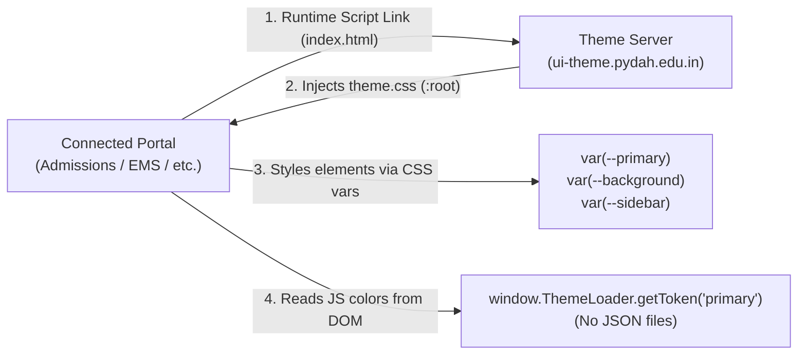

# Connected Application Theme Integration Guide
### Page-by-Page Migration & Centralized Runtime Theme Consumption

> **Production Service**: `https://ui-theme.pydah.edu.in`  
> **Local Service**: `http://localhost:7000` (Theme Server) / `http://localhost:7001` (Theme Editor)  
> **Production Distributable CSS**: `https://ui-theme.pydah.edu.in/themes/theme.css`  
> **Production Runtime Loader SDK**: `https://ui-theme.pydah.edu.in/themes/theme-loader.js`  
> **Version Polling Target**: `https://ui-theme.pydah.edu.in/themes/version.json`  

---

## ⚠️ Fundamental Rule: ZERO Local Theme Files

> [!IMPORTANT]
> **Connected applications MUST NOT store any theme JSON or CSS files in their source code or repositories.**
> - **DO NOT** download, commit, or copy `theme.json`, `active-theme.json`, or local color palettes into your project.
> - Connected applications are **100% stateless runtime consumers**.
> - Theme source of truth is managed exclusively by the centralized Theme Server (`ui-theme.pydah.edu.in`).
> 
> ### Why Local Theme Files Are Prohibited:
> 1. **Version Drift**: If you store a local JSON file, your portal freezes on old colors and will NOT update when new brand themes are published.
> 2. **Redeployment Overhead**: Whenever brand colors change, you would have to manually update JSON files and rebuild/redeploy every single portal.
> 3. **Git Merge Conflicts**: Multiple developers editing local theme JSON files triggers merge conflicts across portal repositories.
> 4. **Runtime Desynchronization**: Other connected portals will be running the new theme while yours remains outdated.

### How Connected Portals Consume Themes (Zero Local State)



---

## 1. Overview & Strategy

When connecting an existing portal (Vite, Next.js, Create-React-App, Vue, Vanilla HTML) that already has disparate, hardcoded colors scattered across multiple pages, **do not attempt to replace all colors at once**.

Follow this **page-by-page migration process**:
1. **Load the centralized runtime script** (takes 2 minutes, zero files to download).
2. **Review the Master Token Dictionary** below to map your existing hardcoded colors.
3. **Migrate Page 0 (Layout Shell: Sidebar & Navbar)**.
4. **Migrate Page by Page (Dashboard -> Tables -> Forms -> Modals)**.
5. **Verify live updates with the Theme Editor** running side-by-side.

---

## 2. Quick Setup (Step 1)

### Production Integration Tag (Recommended for Live Portals)

Add this script tag inside your portal's `index.html` `<head>`:

```html
<!-- Centralized Theme Runtime Loader (Production) -->
<script 
  src="https://ui-theme.pydah.edu.in/themes/theme-loader.js" 
  data-theme-server="https://ui-theme.pydah.edu.in"
  data-poll-interval="30">
</script>
```

---

### Local Development Tag (When Testing Locally)

```html
<!-- Centralized Theme Runtime Loader (Local Testing) -->
<script 
  src="http://localhost:7000/themes/theme-loader.js" 
  data-theme-server="http://localhost:7000"
  data-poll-interval="10">
</script>
```

---

### Option B: Next.js (App Router: `app/layout.jsx` or `app/layout.tsx`)

In your root layout:

```tsx
import Script from 'next/script';

export default function RootLayout({ children }: { children: React.ReactNode }) {
  const themeServer = process.env.NODE_ENV === 'production' 
    ? 'https://ui-theme.pydah.edu.in' 
    : 'http://localhost:7000';

  return (
    <html lang="en">
      <head>
        {/* Load theme loader before interactive to prevent flash */}
        <Script
          src={`${themeServer}/themes/theme-loader.js`}
          strategy="beforeInteractive"
          data-theme-server={themeServer}
          data-poll-interval={process.env.NODE_ENV === 'production' ? 30 : 10}
        />
        {/* Direct CSS link fallback */}
        <link rel="stylesheet" href={`${themeServer}/themes/theme.css`} />
      </head>
      <body>{children}</body>
    </html>
  );
}
```

---

### Option C: Next.js (Pages Router: `pages/_document.jsx`)

```jsx
import { Html, Head, Main, NextScript } from 'next/document';

export default function Document() {
  const themeServer = process.env.NODE_ENV === 'production'
    ? 'https://ui-theme.pydah.edu.in'
    : 'http://localhost:7000';

  return (
    <Html lang="en">
      <Head>
        <script 
          src={`${themeServer}/themes/theme-loader.js`}
          data-theme-server={themeServer} 
          data-poll-interval={process.env.NODE_ENV === 'production' ? 30 : 10}
        />
      </Head>
      <body>
        <Main />
        <NextScript />
      </body>
    </Html>
  );
}
```

---

## 3. Master Token Dictionary

Every color needed across an enterprise application is standardized into these CSS Custom Properties:

| Category | CSS Variable | What It Replaces in Existing Portals | Example Usage |
|---|---|---|---|
| **Brand Primary** | `var(--primary)` | Main brand buttons, active tabs, header highlights | `background: var(--primary);` |
| **Brand Hover** | `var(--primary-hover)` | Button `:hover` and `:focus` states | `background: var(--primary-hover);` |
| **Brand Light Tint** | `var(--primary-light)` | Active nav item background, selected table rows | `background: var(--primary-light);` |
| **Brand RGB (Opacity)** | `var(--primary-rgb)` | Transparent overlays, shadows, glassmorphism | `background: rgba(var(--primary-rgb), 0.15);` |
| **Brand Secondary** | `var(--secondary)` | Secondary action buttons, badge accents | `background: var(--secondary);` |
| **Accent / Highlight** | `var(--accent)` | KPI callouts, progress bars, chart accents | `color: var(--accent);` |
| **Shade Scales** | `var(--primary-50)` to `var(--primary-900)` | 10 automatic lightness steps (50 is lightest, 900 is darkest) | `border-color: var(--primary-200);` |
| **Page Canvas** | `var(--background)` | Global body background (replaces `#f7f9f7`, `#f8fafc`, `#fff`) | `background-color: var(--background);` |
| **Card / Surface** | `var(--surface)` | Card boxes, table containers, dropdown menus, modals | `background-color: var(--surface);` |
| **Sidebar BG** | `var(--sidebar)` | Navigation sidebar background | `background-color: var(--sidebar);` |
| **Sidebar Text** | `var(--sidebar-text)` | Nav link text in dark or light sidebars | `color: var(--sidebar-text);` |
| **Sidebar Muted** | `var(--sidebar-muted)` | Nav category labels, icons in sidebar | `color: var(--sidebar-muted);` |
| **Navbar BG** | `var(--navbar)` | Top navigation bar background | `background-color: var(--navbar);` |
| **Text (Primary)** | `var(--text-primary)` | Main headings (`h1`, `h2`), high-contrast body text | `color: var(--text-primary);` |
| **Text (Secondary)** | `var(--text-secondary)` | Subtitles, labels, table headers, descriptions | `color: var(--text-secondary);` |
| **Text (Muted)** | `var(--text-muted)` | Timestamps, placeholder text, hints | `color: var(--text-muted);` |
| **Borders** | `var(--border)` | Subtle card dividers, table borders, panel separators | `border: 1px solid var(--border);` |
| **Strong Borders** | `var(--border-strong)` | Form input borders, active outlines, table headers | `border: 1px solid var(--border-strong);` |
| **Success** | `var(--success)` | Paid badges, approved statuses, positive counters | `color: var(--success);` |
| **Warning** | `var(--warning)` | Pending reviews, cautionary alerts, late warnings | `color: var(--warning);` |
| **Danger** | `var(--danger)` | Overdue fees, failed actions, delete buttons | `color: var(--danger);` |
| **Info** | `var(--info)` | Academic notices, informational alerts | `color: var(--info);` |

---

## 4. If Your Portal Uses Tailwind CSS (Fastest Migration)

If your existing application uses Tailwind CSS, **you do not need to rewrite hundreds of JSX classes**.

Map Tailwind color names directly to the CSS variables in `tailwind.config.js`:

```javascript
// tailwind.config.js
module.exports = {
  content: ['./index.html', './src/**/*.{js,ts,jsx,tsx}'],
  theme: {
    extend: {
      colors: {
        primary: {
          DEFAULT: 'var(--primary)',
          hover: 'var(--primary-hover)',
          light: 'var(--primary-light)',
          50: 'var(--primary-50)',
          100: 'var(--primary-100)',
          200: 'var(--primary-200)',
          300: 'var(--primary-300)',
          400: 'var(--primary-400)',
          500: 'var(--primary-500)',
          600: 'var(--primary-600)',
          700: 'var(--primary-700)',
          800: 'var(--primary-800)',
          900: 'var(--primary-900)',
        },
        secondary: {
          DEFAULT: 'var(--secondary)',
        },
        accent: {
          DEFAULT: 'var(--accent)',
        },
        surface: 'var(--surface)',
        background: 'var(--background)',
        sidebar: {
          DEFAULT: 'var(--sidebar)',
          text: 'var(--sidebar-text)',
          muted: 'var(--sidebar-muted)',
        },
        navbar: 'var(--navbar)',
        border: {
          DEFAULT: 'var(--border)',
          strong: 'var(--border-strong)',
        },
        'text-main': 'var(--text-primary)',
        'text-sub': 'var(--text-secondary)',
        'text-muted': 'var(--text-muted)',
        success: 'var(--success)',
        warning: 'var(--warning)',
        danger: 'var(--danger)',
        info: 'var(--info)',
      }
    }
  }
};
```

**Now existing Tailwind utility classes automatically inherit central themes**:
- `bg-primary` -> automatically updates to the active theme color!
- `bg-surface` -> automatically updates to surface!
- `text-primary` -> automatically adapts!
- `border-border` -> automatically harmonizes with borders!

---

## 5. Page-by-Page Migration Walkthrough

To avoid breaking existing pages, migrate in this sequence:

### Step 5.1: Global Shell (`Navbar` & `Sidebar`)
Open your root layout or main shell component:

```diff
- <div className="sidebar" style={{ background: '#145A3A', color: '#fff' }}>
+ <div className="sidebar" style={{ background: 'var(--sidebar)', color: 'var(--sidebar-text)' }}>

- <header className="navbar" style={{ background: '#ffffff', borderColor: '#e2e8f0' }}>
+ <header className="navbar" style={{ background: 'var(--navbar)', borderColor: 'var(--border)' }}>

- <a className="nav-item active" style={{ background: '#1c6a46' }}>
+ <a className="nav-item active" style={{ background: 'var(--primary-light)', color: 'var(--primary)' }}>
```

**Verify**: Navigate to any page. The header and sidebar now adapt to any theme published in the Theme Editor!

---

### Step 5.2: Dashboard Page (`Dashboard.jsx`)
On your dashboard overview, update the canvas background and KPI metric cards:

```diff
- <main style={{ backgroundColor: '#f8fafc', color: '#1e293b' }}>
+ <main style={{ backgroundColor: 'var(--background)', color: 'var(--text-primary)' }}>

- <div className="metric-card" style={{ backgroundColor: '#ffffff', borderColor: '#e2e8f0' }}>
+ <div className="metric-card" style={{ backgroundColor: 'var(--surface)', borderColor: 'var(--border)' }}>
    
-   <h3 style={{ color: '#64748b' }}>Total Revenue</h3>
+   <h3 style={{ color: 'var(--text-secondary)' }}>Total Revenue</h3>
    
-   <span style={{ color: '#0f172a' }}>$48,500</span>
+   <span style={{ color: 'var(--text-primary)' }}>$48,500</span>
  </div>
```

---

### Step 5.3: Data Tables & List Views (`StudentsList.jsx`, `Orders.jsx`)
Update table containers, headers, row borders, and status tags:

```diff
- <table style={{ backgroundColor: '#ffffff' }}>
+ <table style={{ backgroundColor: 'var(--surface)' }}>
    <thead>
-     <tr style={{ backgroundColor: '#f1f5f9', color: '#475569' }}>
+     <tr style={{ backgroundColor: 'var(--background)', color: 'var(--text-secondary)' }}>
        <th>Roll No</th>
        <th>Student Name</th>
        <th>Status</th>
      </tr>
    </thead>
    <tbody>
      <tr>
-       <td style={{ borderColor: '#e2e8f0', color: '#0f172a' }}>23ENG0101</td>
+       <td style={{ borderColor: 'var(--border)', color: 'var(--text-primary)' }}>23ENG0101</td>
        <td>
-         <span style={{ backgroundColor: '#dcfce7', color: '#15803d' }}>Paid</span>
+         <span style={{ backgroundColor: 'var(--success-light)', color: 'var(--success)' }}>Paid</span>
        </td>
      </tr>
    </tbody>
  </table>
```

---

### Step 5.4: Forms & Input Controls (`AdmissionForm.jsx`, `Settings.jsx`)
Update inputs, labels, and action buttons:

```diff
- <label style={{ color: '#334155' }}>Full Name</label>
+ <label style={{ color: 'var(--text-primary)' }}>Full Name</label>

- <input style={{ backgroundColor: '#ffffff', borderColor: '#cbd5e1', color: '#0f172a' }} />
+ <input style={{ backgroundColor: 'var(--surface)', borderColor: 'var(--border-strong)', color: 'var(--text-primary)' }} />

/* Primary and Outline Buttons */
- <button style={{ backgroundColor: '#145A3A', color: '#ffffff' }}>Submit</button>
+ <button style={{ backgroundColor: 'var(--primary)', color: '#ffffff' }}>Submit</button>

- <button style={{ border: '1px solid #145A3A', color: '#145A3A' }}>Cancel</button>
+ <button style={{ border: '1px solid var(--border-strong)', color: 'var(--primary)' }}>Cancel</button>
```

---

### Step 5.5: Modals, Popovers & Dialogs (`ConfirmModal.jsx`)
```diff
  <div className="modal-backdrop" style={{ background: 'rgba(0, 0, 0, 0.45)' }}>
-   <div className="modal-window" style={{ backgroundColor: '#ffffff', borderColor: '#e2e8f0' }}>
+   <div className="modal-window" style={{ backgroundColor: 'var(--surface)', borderColor: 'var(--border-strong)' }}>
-     <h4 style={{ color: '#0f172a' }}>Confirm Status</h4>
+     <h4 style={{ color: 'var(--text-primary)' }}>Confirm Status</h4>
-     <p style={{ color: '#64748b' }}>Are you sure you want to proceed?</p>
+     <p style={{ color: 'var(--text-secondary)' }}>Are you sure you want to proceed?</p>
    </div>
  </div>
```

---

## 6. How to Test Your Changes Live

1. Keep the **Centralized Theme Server** running:
   ```bash
   npm run server
   # Runs on http://localhost:7000
   ```
2. Keep the **Theme Editor** open:
   ```bash
   npm run editor
   # Runs on http://localhost:7001
   ```
3. Run your application on its regular port (e.g. `npm run dev` on port `3000`, `5173`, etc.).
4. In the Theme Editor ([http://localhost:7001](http://localhost:7001)):
   - Open **Presets** and select a distinctive theme (e.g., *Royal Navy Classic*, *Midnight Obsidian Dark*, or *Crimson & Amber Heritage*).
   - Click **"Publish Theme"**.
5. Within 10–30 seconds (or immediately upon refresh), **your application will automatically update all migrated elements to the new theme**!
6. If any button or card failed to change color, inspect it in Chrome DevTools to locate the remaining hardcoded HEX value and replace it with the appropriate token from the Master Token Dictionary.

---

## 7. Consuming Theme Colors in JavaScript (Charts, Canvas, React State)

If your application needs color values in JavaScript (e.g. for **Chart.js, Recharts, Canvas, SVG, PDF generation, or dynamic inline styles**), **DO NOT fetch or save JSON files**.

Use the `window.ThemeLoader` SDK helper or the native DOM API:

### Option A: Read Single Token
```javascript
// Using ThemeLoader SDK
const primaryColor = window.ThemeLoader.getToken('primary'); // e.g. "#145A3A"
const backgroundColor = window.ThemeLoader.getToken('background'); // e.g. "#F7F9F7"

// Or using standard browser DOM API (zero dependencies)
const brandPrimary = getComputedStyle(document.documentElement).getPropertyValue('--primary').trim();
```

### Option B: Read All Tokens at Once
```javascript
const tokens = window.ThemeLoader.getTokens();
console.log(tokens.primary);     // "#145A3A"
console.log(tokens.surface);     // "#FFFFFF"
console.log(tokens.sidebar);     // "#145A3A"
console.log(tokens.textPrimary); // "#252B27"
```

### Option C: React Custom Hook (`useThemeTokens.js`)
Create this simple hook in your React portal:

```jsx
import { useState, useEffect } from 'react';

export function useThemeTokens() {
  const [tokens, setTokens] = useState(() => 
    typeof window !== 'undefined' && window.ThemeLoader ? window.ThemeLoader.getTokens() : {}
  );

  useEffect(() => {
    const handleUpdate = () => {
      if (window.ThemeLoader) {
        setTokens(window.ThemeLoader.getTokens());
      }
    };

    window.addEventListener('theme:updated', handleUpdate);
    return () => window.removeEventListener('theme:updated', handleUpdate);
  }, []);

  return tokens;
}
```

#### Example Usage in Chart.js / Recharts Component:
```jsx
import { useThemeTokens } from './useThemeTokens';
import { BarChart, Bar, XAxis, YAxis, Tooltip } from 'recharts';

export function AdmissionsChart({ data }) {
  const { primary, accent, surface, border } = useThemeTokens();

  return (
    <div style={{ backgroundColor: surface, border: `1px solid ${border}`, padding: '16px', borderRadius: '8px' }}>
      <BarChart width={500} height={300} data={data}>
        <XAxis dataKey="name" />
        <YAxis />
        <Tooltip />
        <Bar dataKey="students" fill={primary || '#145A3A'} />
        <Bar dataKey="enrolled" fill={accent || '#0E8388'} />
      </BarChart>
    </div>
  );
}
```

---

## 8. Listening to Theme Events in React

If your application needs to trigger custom logic whenever a theme update is published by the central server:

```jsx
import { useEffect } from 'react';

export default function MyComponent() {
  useEffect(() => {
    const handleThemeChange = (event) => {
      console.log('Central theme updated to version:', event.detail.version);
      // Re-render chart or canvas when new theme arrives
    };

    window.addEventListener('theme:updated', handleThemeChange);
    return () => window.removeEventListener('theme:updated', handleThemeChange);
  }, []);

  return <div>...</div>;
}
```

---

## 9. Offline & Server Outage Resilience

If the central theme server is down or experiencing temporary network issues:
- `theme-loader.js` **preserves the last successfully loaded theme** stored in `localStorage`.
- If the application is opened for the first time while offline, the loader injects standard fallback tokens automatically.
- **Your application will never crash or display blank unstyled pages**.
